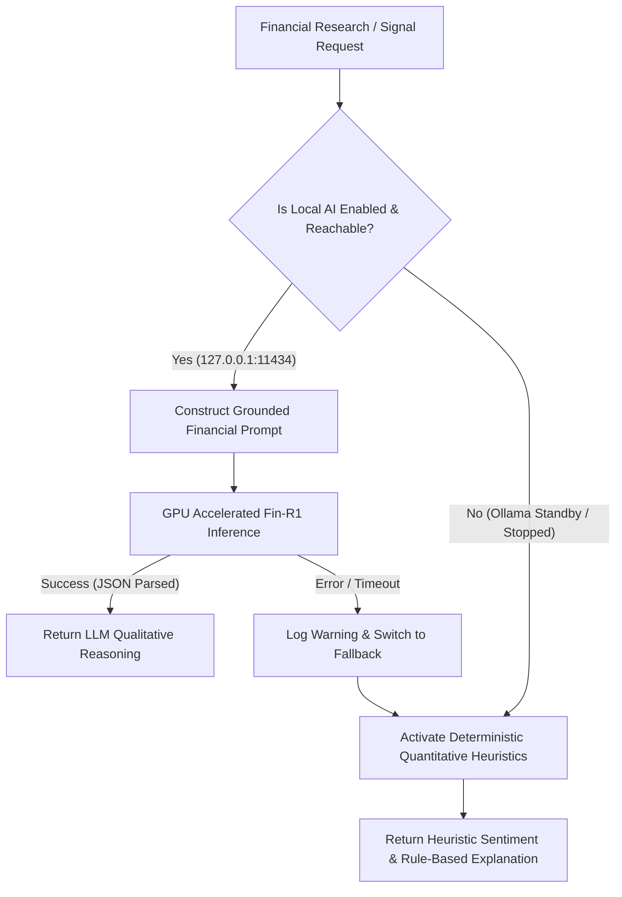

# AI Runtime Configuration & Environment Specification

**Project:** Northstar — Indian Equity AI Quantitative Research & Paper-Trading Platform  
**Component:** Local AI Model Execution Runtime  
**Protocol:** Localhost HTTP / Ollama v1 API / OpenAI-Compatible REST  

---

## 1. Environment Variable Specification

The following variables govern local AI inference in `.env` and `src/trader/config/settings.py`:

```env
# ==============================================================================
# LOCAL SPECIALIST FINANCIAL AI RUNTIME (FIN-R1 GGUF)
# ==============================================================================
LOCAL_AI_PROVIDER=ollama
LOCAL_AI_BASE_URL=http://127.0.0.1:11434
LOCAL_AI_OPENAI_BASE_URL=http://127.0.0.1:11434/v1
LOCAL_AI_MODEL=fin-r1:7b-q4_k_m
LOCAL_AI_CONTEXT_SIZE=4096
LOCAL_AI_TIMEOUT_SECONDS=120
LOCAL_AI_MAX_CONCURRENT_REQUESTS=1
LOCAL_AI_TEMPERATURE=0.1
LOCAL_AI_TOP_P=0.95
LOCAL_AI_ENABLED=true
LOCAL_AI_DEVICE=cuda
LOCAL_AI_GPU_LAYERS=33
```

---

## 2. Parameter Tuning Rationale

1. **`LOCAL_AI_CONTEXT_SIZE=4096`**:
   - Standard financial filings, earnings excerpts, and technical indicator vectors require approximately 1,500 to 3,000 tokens.
   - A 4,096-token KV cache on Qwen 2.5 7B consumes ~450 MiB of VRAM in FP16, preserving ample headroom within the 8.15 GB GPU VRAM envelope.
2. **`LOCAL_AI_TEMPERATURE=0.1`**:
   - Financial reasoning demands determinism, numerical consistency, and minimal creative hallucination. A near-zero temperature forces greedy sampling on logical tokens.
3. **`LOCAL_AI_MAX_CONCURRENT_REQUESTS=1`**:
   - The workstation runs a single NVIDIA RTX 5060 Laptop GPU. Serializing inference requests avoids KV cache thrashing and out-of-memory errors while preserving sub-second latency for background research.
4. **`LOCAL_AI_TIMEOUT_SECONDS=120`**:
   - Complete corporate dossier generation synthesizing technicals, macroeconomic regime, and news flow can take 5 to 15 seconds on GPU. A 120-second timeout prevents premature disconnection during heavy background system load.

---

## 3. Resilience & Fallback Matrix



- **Fail-Open Strategy:** If the local model is starting up or stopped, API endpoints never return HTTP 500 errors. Instead, `LocalFinancialAIClient` seamlessly transitions into `STANDBY_HEURISTIC` mode using `EventClassifier` and deterministic technical indicators.
- **Strict Boundary:** The AI qualitative layer can never alter trade prices, invalidation stop-loss levels, position sizes, or force order execution. All order lifecycle logic resides in `trader.core.engine`.

