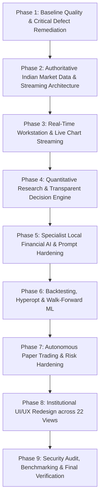

# Northstar: Comprehensive Architecture & Quality Audit

**Date:** 2026-11-05  
**Auditor:** Quantitative Systems Architect & Lead Software Engineer  
**Baseline Commit:** `6a4bb3a992b1ddcca9634b0b02b36d5fbb96cc8a`  
**Active Working Branch:** `feature/northstar-live-market-data-and-ai-platform`  
**Host Environment:** Windows 11 Home, AMD Ryzen 9 8940HX (16C/32T, 24GB RAM), NVIDIA GeForce RTX 5060 Laptop GPU (8GB VRAM, Driver 592.82, CUDA 13.1)

---

## 1. Executive Summary

Northstar is a quantitative research, financial intelligence, and simulated paper-trading platform tailored for Indian cash equity markets (NSE). A comprehensive static, runtime, and environment audit was conducted on the repository to evaluate architectural integrity, data provenance, AI service connectivity, risk guardrails, and frontend usability.

While the project features a solid foundation—with 122 passing tests, a 22-view React 19 workstation, event-driven backtesting with statutory Indian delivery costs, and an autonomous paper-trading daemon—critical engineering deficiencies have been identified that must be remediated to achieve institutional-grade reliability.

---

## 2. Environment & Hardware Audit

| Subsystem | Verified State | Audit Finding / Implication |
| :--- | :--- | :--- |
| **Operating System** | Windows 11 Build 10.0.26300 | Compatible with Python 3.12 and Node.js 22. |
| **CPU** | AMD Ryzen 9 8940HX (16 Cores, 32 Threads) | High multi-threaded capability for vector backtesting and parallel scans. |
| **RAM** | 24 GB DDR5 | Ample memory for in-memory candle caches and walk-forward ML models. |
| **GPU / VRAM** | NVIDIA GeForce RTX 5060 Laptop GPU (8151 MiB VRAM) | CUDA 13.1 available. 8GB VRAM ceiling permits quantized 7B/8B models (Q4_K_M ~5.2GB) with ~2.8GB headroom. |
| **Local LLM Runtime** | **Ollama CLI NOT installed in PATH** | `ollama` command not found; no GGUF files in `~/.ollama` or `D:\AI-Models`. Local AI currently operates exclusively in **Deterministic Heuristic Fallback** mode. |
| **Disk Storage** | C: 206 GB free, D: 233 GB free, E: 233 GB free | Dedicated directory `D:\AI-Models\Northstar\` can safely host future LLM weights outside Git. |

---

## 3. Investigation & Reproduction of Identified Critical Defects

### 3.1 Charts Not Updating in Real Time (`StockResearchView.tsx`)
- **Defect:** `StockResearchView.tsx` issues a single REST query `getHistoricalCandles()` via React Query with no WebSocket streaming subscription or periodic polling interval.
- **Impact:** Once loaded, the candlestick chart remains static until a full page reload occurs.
- **Root Cause:** Absence of a continuous WebSocket/SSE quote streaming client and failure to bind the latest incoming tick to the active unfinished candle.
- **Remediation Plan:** Implement a live quote streaming channel (WebSocket with HTTP polling fallback), bind real-time ticks to the open candle without re-rendering historical SVG geometry, and display live connection telemetry.

### 3.2 Timeframe Parameter Ignored in Candles API (`src/trader/api/app.py`)
- **Defect:** The endpoint `/api/v1/instruments/{symbol}/candles` accepts a `timeframe` query parameter, but the underlying provider call forwards `Timeframe.DAILY` or ignores the parameter during CSV/synthetic fetching.
- **Impact:** Requesting 1-minute or 15-minute candles returns daily bars labeled incorrectly, risking severe multi-timeframe analytical distortion.
- **Remediation Plan:** Implement dynamic candle resampling and aggregation (`resample_candles()`) supporting `1m`, `3m`, `5m`, `15m`, `30m`, `1h`, `1d`, and `1w` adhering to official NSE session hours (09:15-15:30 IST). Never label daily bars as minute bars.

### 3.3 Synthetic Prices Must Never Masquerade as Real Prices
- **Defect:** `SyntheticDataProvider` and `SyntheticDataGenerator` generate realistic Brownian motion candles, but some endpoints generated current timestamps without explicit simulation disclaimers.
- **Impact:** Risk of confusing simulated test data with exchange ticks.
- **Remediation Plan:** Enforce strict provenance labeling across all API models (`DataSource.SYNTHETIC`, `DataSource.HISTORICAL`, `DataSource.DHAN`, `DataSource.TRUEDATA`). Strip manufactured bid/ask spreads when not provided by exchange feeds.

### 3.4 Feed Health Model Overly Permissive (`data_health` in `app.py`)
- **Defect:** In `app.py`, `last_tick_time = getattr(provider, "_last_update", datetime.now(IST))`. If a provider had no `_last_update`, it defaulted to the current time, reporting the feed as `HEALTHY` even when disconnected!
- **Impact:** False sense of live data connectivity.
- **Remediation Plan:** Transition feed health to 11 discrete, mutually exclusive states: `NOT_CONFIGURED`, `CONNECTING`, `CONNECTED`, `RECEIVING_DATA`, `HEALTHY`, `STALE`, `DISCONNECTED`, `ERROR`, `MARKET_CLOSED`, `HISTORICAL_ONLY`, `SYNTHETIC_ONLY`. Fail closed when timestamps are missing.

### 3.5 Historical Candle Fallback False Stop-Loss Triggers (`src/trader/paper/daemon.py`)
- **Defect:** In `_evaluate_open_positions()`, if `get_latest_quote()` failed, the daemon fell back to `candles[-1].close` to evaluate stop-loss and profit target hits during live runs.
- **Impact:** An old historical close could trigger a simulated stop-loss sale during an active trading session.
- **Remediation Plan:** Forbid stop-loss execution on unverified historical candle closes during active market hours. If quote data is unavailable or stale, pause position actions, mark feed status as `STALE`, and log the delay in the audit repository.

### 3.6 DhanHQ Integration Verification Requirements (`dhan_adapter.py`)
- **Defect:** Current adapter assumes simplistic JSON paths and lacks official Security ID resolution, packet parsing for binary market-depth packets, and token renewal validation.
- **Impact:** Unverified live integration.
- **Remediation Plan:** Map NSE symbols to verified Dhan Security IDs via a static/dynamic instrument master, implement official Dhan 5-depth quote schemas, assert read-only isolation (no order routing imports), and report unconfigured/standby status when credentials are missing.

### 3.7 TrueData Integration Completeness (`truedata_adapter.py`)
- **Defect:** `get_latest_quote()` previously raised `NotImplementedError`, and WebSocket parsing was partially implemented with manufactured bid/ask percentages.
- **Impact:** Incomplete vendor client.
- **Remediation Plan:** Complete TrueData WebSocket connection lifecycle, parse live tick and order book packets, eliminate artificial bid/ask derivations, and report disabled/standby mode when credentials are absent.

### 3.8 Live Connection Truthfulness in Status APIs
- **Defect:** Checking environment variables alone was previously treated as proof of provider connectivity.
- **Impact:** Misleading operational telemetry.
- **Remediation Plan:** Decouple `is_configured` (credentials present) from `is_connected` (authenticated session active and ticks received). The UI must display genuine status indicators.

---

## 4. Subsystem Audit

### 4.1 Data Architecture & Quality Layer
- **Status:** Functional for CSV & Synthetic; requires formal data quality validation engine.
- **Recommendation:** Implement `src/trader/data/quality.py` with granular out-of-order, abnormal spike, and corrupted bar quarantine checks.

### 4.2 Strategy & Quantitative Engine
- **Status:** 5 deterministic strategies implemented (`BaselineSwing`, `Momentum`, `DonchianBreakout`, `RelativeStrength`, `NewsSentiment`).
- **Recommendation:** Ensure lookahead detector runs on all strategy variants and enforce point-in-time calculation constraints.

### 4.3 Machine Learning Pipeline
- **Status:** Chronological walk-forward splits with purge gaps; 3 models saved in `models/saved/`.
- **Recommendation:** Isolate ML return predictions from qualitative LLM reasoning. Implement explicit calibration curves and Precision@K benchmarking.

### 4.4 Financial Intelligence & Local AI
- **Status:** GDELT client, corporate announcements, and rule-based classifier functional. `LocalFinancialAIClient` operates in deterministic heuristic fallback due to absence of Ollama runtime.
- **Recommendation:** Unify configuration (canonical endpoint `http://127.0.0.1:11434/v1` for Ollama, `http://127.0.0.1:8080/v1` for llama.cpp). Transparently label all AI outputs with exact generation source (`LOCAL_LLM` vs `HEURISTIC_FALLBACK`).

### 4.5 Paper Trading & Risk Management
- **Status:** Full accounting engine with ₹10,000 capital, 2% risk sizing, and autonomous daemon.
- **Recommendation:** Reconcile default risk budget to **0.5% of equity** (₹50 planned loss per trade) for small capital preservation, allowing user configuration up to 2.0%.

### 4.6 Frontend UI/UX Workstation
- **Status:** React 19 + TypeScript + Vite with 22 views. Tailwind CSS v4 integrated.
- **Recommendation:** Structure navigation into 5 core workspaces (Workspace, Quant Research, AI Research, Paper Trading, Risk & System). Integrate real-time WebSocket chart updates, remove all visual slop, and ensure 100% of interactive controls execute verified backend commands.

---

## 5. Prioritized Engineering Roadmap

---

## 6. Verification & Governance Contract

Every phase will be backed by unit and integration tests. No code will be merged or declared complete without:
1. 100% pytest pass rate.
2. Clean TypeScript typecheck (`tsc -b`) and Vite production build.
3. Live browser Playwright screenshot verification across responsive viewports.
4. Total adherence to fail-closed safety and paper-trading isolation.
